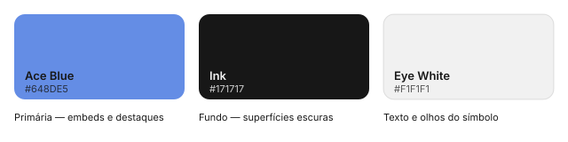

# Manual de marca — Ace

Identidade visual do Ace, bot do Fluxer. Os valores canônicos de cor vivem em `src/brand.ts`; este documento explica como usá-los.

## Símbolo

O símbolo do Ace é um círculo azul com dois olhos brancos inclinados a 22°, levemente deslocados para cima e para a direita — um rosto simples, sem boca.

| Arquivo | Uso |
|---|---|
| `assets/ace.svg` | Versão principal, fundo transparente |
| `assets/ace-black.svg` / `assets/ace-black.png` | Monocromática escura (fundo claro) |
| `assets/ace-white.svg` / `assets/ace-white.png` / `assets/ace-white-small.*` | Monocromática clara (fundo escuro) |
| `assets/ace.png` | Versão raster 1024×1024 |
| `assets/ace-face.jpg` | Ilustração do mascote para avatar e divulgação |

### Lockups

Símbolo + wordmark `ace` em minúsculas, Geist/Inter, peso 600, tracking −1:

- `assets/brand/wordmark-dark.svg` — texto Ink, para fundos claros
- `assets/brand/wordmark-light.svg` — texto Eye White, para fundos escuros

### Respiro e tamanho mínimo

- Respiro: metade do diâmetro do círculo em todos os lados.
- Tamanho mínimo do símbolo: 16 px. Abaixo disso os olhos viram borrão.
- O símbolo funciona sozinho como avatar/ícone; o lockup é para contextos onde o nome precisa aparecer.

### Usos incorretos

- Não mudar a cor do círculo ou dos olhos.
- Não girar, achatar ou deformar o símbolo.
- Não adicionar boca, contorno ou sombra.
- Não usar o símbolo colorido sobre fundo azul — use a versão branca.
- Não escrever o nome em maiúsculas ("ACE"); é sempre `ace` ou `Ace` no início de frase.

## Cores

| Nome | Hex | Papel |
|---|---|---|
| Ace Blue | `#648DE5` | Primária: embeds, links, destaques, o círculo do símbolo |
| Ink | `#171717` | Fundo escuro, cor de embeds de sistema (`userbanner`, `emojidump`) |
| Eye White | `#F1F1F1` | Texto sobre Ink, os olhos do símbolo |

No código, nunca escreva o hex à mão: importe `brand` de `src/brand.ts` (`primary`, `eyes`, `background`). A CLI pinta o selo do dev com Ace Blue sobre Ink (`src/term.ts`).

## Tipografia

- **Geist** — títulos, nomes e texto de interface (site, manuais). Fallback: Inter, system-ui.
- **Geist Mono** — comandos, código e respostas do bot quando citadas em texto (`a.ping`, `pong!`).

Nos embeds do Fluxer vale a fonte do cliente; a regra acima é para superfícies nossas (site, imagens, documentos).

## Voz e tom

- Português brasileiro, informal e direto.
- Respostas curtas: `pong!`, `trancado.`, `feito.` — verbo ou confirmação, sem burocracia.
- O nome do bot aparece em minúsculas nas respostas (`ace`), em Ace Blue quando destacado.
- Nada de caps lock, exclamações em série ou emojis decorativos fora do catálogo do bot (`src/emoji.ts`).

## Social

- `assets/brand/og.png` — card 1200×630 para `og:image` e links compartilhados.
- `assets/brand/palette.svg` — chips da paleta usados neste manual.
- `assets/readme/banner.gif` — banner do README.
